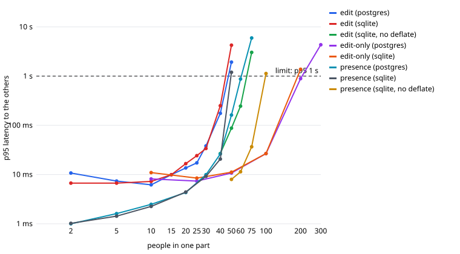

# How many people can work on one part

A load test of one openswx-collab server with N people working live in the same part document, run on SQLite
and on PostgreSQL. It covers active editing (edits with presence), people who only watch and move pointers
(presence only), and edits without presence (to isolate the database).

## Results

| on one document | SQLite | PostgreSQL | first thing to go |
|---|--:|--:|---|
| **people editing** (presence plus an edit every 5 s each) | **40** (50 breaks) | **40** (50 breaks) | edit latency: changes wait for the room lock |
| **people only watching and moving pointers** | **40 to 50** (50 broke once in three runs) | **60** (75 breaks) | presence latency, then sockets closed as too slow (4408) |
| edits with no presence (database isolated) | 100 (200 breaks) | 200, borderline (300 breaks) | the room lock: about 30 commits/s per document at most |
| people editing, with permessage-deflate off | 60 (75 breaks) | not run | edit latency |
| people watching, with permessage-deflate off | 75 (100 breaks) | not run | sockets closed as too slow |

"Breaks" means p95 edit fan-out (presence latency for watchers) above 1 s, anything lost or out of order, a
connection failing, an error in the server log, or the server's CPU or memory exhausted. At the limits above,
p95 was 175 to 250 ms for edits and 26 to 160 ms for presence. **For a snappy session (p95 under 50 ms), plan on
30 people per part on this hardware.**

What did not break, at any step: no server log errors, no change lost or delivered out of order, every simulated
person ended at the server's head, and the real openswx app finished in sync every time. Memory stayed between
100 and 170 MB. The server process never used a whole core by its own CPU count. It fails by **queueing**: every
message and every lock hand-off waits for one busy event loop, and the wait grows faster than the load.

Both backends break at the same point for editing and for watching, because neither of those limits is the
database. The backend matters only when edits are all there is: PostgreSQL got through about 30 % more commits
per second than SQLite before the room lock saturated.



## Method

`tools/load_test.py run` starts its own server (`serve`, with a temporary SQLite file, or a throwaway PostgreSQL
16 from `pixeltable-pgserver` as `tools/test_postgres.py` uses), registers made-up accounts
(`loadNNN@example.com`, each invited as a project editor), and for every N opens a fresh copy of a small part
(one sketch, one extrude) and puts N simulated people in it for 20 s. It never connects to a server it did not
start.

Each simulated person is a WebSocket client using the message types in `openswx_collab_protocol`, with
permessage-deflate on as in openswx's client. Each one:

- sends **presence** 20 times a second: a pointer, a selection, the tool and the camera, shaped and sized like
  the openswx UI's, plus a send timestamp and a counter;
- in edit mode, **edits every 5 s on average** (±50 %, so a 50-person room makes about 10 edits a second). The
  first edit reserves an id and a name and adds the person's own sketch (`ids.reserve`, then a `change` with a
  `feature.add` made by `ops.diff`). Later edits take the sketch's lock, move its rectangle (`feature.update`)
  and release the lock, as the openswx panel does;
- pings like openswx (every 15 s). One person per load process pings every second and times the pong, which
  shows how late the server's event loop is running.

The people are spread across 8 processes. The busiest one never went above 17 % of a core, so the load
generator was never the bottleneck.

**A real openswx app** joins every step (`tools/load_probe.py`, run with an openswx checkout's Python). It signs
in and opens the document with openswx's own `collab_sign_in` and `collab_open`. It sends presence 20 times a
second through `send_presence`, as the UI does. Once a second it times `collab_status`, a command that waits
behind whatever the app is doing, such as rebuilding for others' changes. Every 3 s it changes the extrude's
depth with `edit_feature`, which rebuilds, sends the change and waits for the server's answer. At the end it
must be at the server's head, with its replicated copy byte-identical to the server's content.

**Measured per step.** Latency histograms are merged across processes. Edit fan-out runs from a change being
sent to each other person receiving it; the send time is carried in the `change_id`, and all processes share
one clock. Edit accept runs from sending to `change.accepted`. Lock runs from `lock.acquire` to `lock.result`.
Presence latency runs from sending to each other person receiving it. Delivery checks that each person sees
every `seq` once and in order, and every other person's presence counter with no gaps. Server CPU and memory
are sampled every 0.5 s with psutil, the log is scanned for ERROR lines and tracebacks, and the step also
records the database size and its rows in the history table.

**Hardware.** One laptop, with server and load on the same machine: Intel Core i7-11800H (8 cores, 16
threads), 16 GB RAM, Windows 11, Python 3.13, uvicorn 0.54 with its websockets-sansio protocol, SQLite in WAL
mode, PostgreSQL 16. On Windows the event loop is asyncio's proactor. A Linux deployment of the Docker image
gets uvloop through `uvicorn[standard]`, which usually runs a loop like this one 1.5 to 2 times faster, so
treat these numbers as a floor. Another benchmark was running on the machine part of the time. Two repeats at
the knee differ noticeably (presence only, N=50: p95 of 45, 661 and 1198 ms in three runs), so read every
limit as plus or minus one step.

Reproduce:

```bash
pip install psutil pixeltable-pgserver asyncpg       # into the server's environment
python tools/load_test.py run --backend sqlite   --mode edit     --steps 2,5,10,15,20,25,30,40,50 --openswx ../openswx
python tools/load_test.py run --backend sqlite   --mode presence --steps 2,5,10,20,30,40,50,60,75,100
python tools/load_test.py run --backend postgres --mode edit-only --steps 10,25,50,100,200,300,500
python tools/load_test.py run ... --no-compression           # the same without permessage-deflate
python tools/load_test.py run ... --profile timing --keep-work  # room-lock and commit timings, loop lag
python tools/load_test.py report results.jsonl --chart chart.svg
```

The raw results are in [`data/`](data/), one JSON line per step.

## Tables

Latencies are in ms. "frames out/s" is what all the simulated people received per second. The server CPU
column is psutil's reading for the server process tree, which was noisy on Windows; the loop-lag timings below
are the better measure of how busy the server is.

### Editing (presence, plus an edit every 5 s per person)

| backend | N | edit fan-out p50 / p95 / p99 | presence p95 | ping p95 | frames out/s | edits/s | server CPU % | RSS MB | openswx edit p95 | verdict |
|---|--:|---|--:|--:|--:|--:|--:|--:|--:|---|
| SQLite | 2 | 4.4 / 6.7 / 6.7 | 0.8 | 0.8 | 82 | 0.4 | 0.6 | 103 | 16 | ok |
| SQLite | 10 | 4.8 / 7.2 / 8.8 | 2.9 | 2.7 | 2 054 | 2.0 | 1.5 | 106 | 16 | ok |
| SQLite | 20 | 6.8 / 17 / 25 | 7.0 | 5.7 | 8 227 | 3.9 | 3.9 | 111 | 30 | ok |
| SQLite | 25 | 9.9 / 24 / 71 | 7.1 | 6.8 | 12 847 | 4.9 | 6.5 | 115 | 36 | ok |
| SQLite | 30 | 16 / 34 / 52 | 10 | 9.0 | 18 504 | 5.8 | 27 | 111 | 70 | ok |
| SQLite | 40 | 89 / 251 / 312 | 27 | 25 | 32 881 | 7.5 | 38 | 116 | 333 | ok |
| SQLite | 50 | 2 085 / 4 254 / 4 605 | 2 698 | 2 396 | 48 652 | 5.1 | 48 | 122 | 8 910 | **breaks**: fan-out, 27 832 presence frames dropped |
| PostgreSQL | 2 | 4.5 / 11 / 11 | 0.8 | 1.0 | 82 | 0.4 | 0.5 | 106 | 12 | ok |
| PostgreSQL | 10 | 4.9 / 6.2 / 9.9 | 2.1 | 2.0 | 2 054 | 2.0 | 1.8 | 108 | 17 | ok |
| PostgreSQL | 20 | 6.8 / 14 / 20 | 5.0 | 4.7 | 8 232 | 3.9 | 4.0 | 115 | 23 | ok |
| PostgreSQL | 25 | 7.2 / 17 / 35 | 7.0 | 7.1 | 12 859 | 4.9 | 5.8 | 112 | 41 | ok |
| PostgreSQL | 30 | 13 / 38 / 99 | 9.6 | 9.4 | 18 497 | 5.8 | 30 | 116 | 55 | ok |
| PostgreSQL | 40 | 73 / 175 / 214 | 15 | 14 | 32 891 | 7.7 | 73 | 118 | 146 | ok |
| PostgreSQL | 50 | 1 403 / 1 927 / 2 127 | 1 297 | 1 085 | 50 008 | 6.0 | 78 | 125 | 4 587 | **breaks**: fan-out |
| SQLite, no deflate | 40 | 11 / 27 / 32 | 5.7 | 5.1 | 32 149 | 7.8 | 19 | 110 | | ok |
| SQLite, no deflate | 50 | 43 / 88 / 232 | 7.8 | 7.8 | 50 424 | 9.8 | 30 | 115 | | ok |
| SQLite, no deflate | 60 | 83 / 246 / 337 | 18 | 28 | 72 781 | 11.6 | 25 | 119 | | ok |
| SQLite, no deflate | 75 | 2 349 / 3 038 / 3 161 | 2 303 | 2 170 | 108 666 | 8.7 | 35 | 120 | | **breaks**: fan-out, presence gaps |

The openswx column is the real app's `edit_feature` time: local rebuild, the change, and the server's answer.
Its `collab_status` p95 followed the same curve: 6 ms at N=2, 68 ms at 30, 309 ms at 40 and 7.9 s at 50, which
is how slow the app feels while it waits behind the collaboration traffic.

### Watching only (presence)

| backend | N | presence p50 / p95 / p99 | ping p95 | frames out/s | server CPU % | RSS MB | verdict |
|---|--:|---|--:|--:|--:|--:|---|
| SQLite | 10 | 1.3 / 2.2 / 2.7 | 2.2 | 1 996 | 1.2 | 106 | ok |
| SQLite | 20 | 2.9 / 4.4 / 5.3 | 4.3 | 8 033 | 3.1 | 108 | ok |
| SQLite | 30 | 5.0 / 9.2 / 13 | 9.7 | 18 001 | 23 | 112 | ok |
| SQLite | 40 | 9.7 / 21 / 30 | 18 | 31 982 | 53 | 115 | ok |
| SQLite | 50 | 172 / 1 198 / 1 403 | 1 043 | 49 036 | 54 | 116 | **breaks** (repeats: p95 45 and 661 ms) |
| PostgreSQL | 10 | 1.3 / 2.5 / 4.2 | 2.4 | 1 998 | 1.7 | 108 | ok |
| PostgreSQL | 20 | 2.7 / 4.3 / 5.3 | 4.2 | 8 035 | 1.1 | 111 | ok |
| PostgreSQL | 30 | 5.3 / 9.9 / 15 | 9.7 | 18 009 | 18 | 116 | ok |
| PostgreSQL | 40 | 9.0 / 26 / 41 | 25 | 32 037 | 63 | 114 | ok |
| PostgreSQL | 50 | 50 / 162 / 206 | 179 | 49 957 | 76 | 121 | ok |
| PostgreSQL | 60 | 599 / 873 / 1 002 | 926 | 71 690 | 79 | 124 | ok, at the edge |
| PostgreSQL | 75 | 4 009 / 5 957 / 6 197 | 4 984 | 71 252 | 77 | 142 | **breaks**: 33 connections lost |
| SQLite, no deflate | 50 | 4.8 / 8.0 / 10 | 8.8 | 49 007 | 46 | 111 | ok |
| SQLite, no deflate | 60 | 8.2 / 11 / 16 | 11 | 70 787 | 71 | 114 | ok |
| SQLite, no deflate | 75 | 23 / 37 / 47 | 33 | 111 056 | 75 | 122 | ok |
| SQLite, no deflate | 100 | 5.0 / 1 129 / 1 174 | 1 085 | 37 402 | 17 | 146 | **breaks**: 68 connections closed as too slow (4408) |

Presence never touches the database, so the backend makes no difference here. The PostgreSQL and SQLite rows
differ only by run-to-run noise. Throughput tops out near 71 000 frames/s with deflate and 111 000 without.
Beyond that the server's per-socket queues grow until it closes sockets as too slow.

### Edits only (no presence)

| backend | N | edit fan-out p50 / p95 / p99 | edits/s committed | ping p95 | history rows / KB | verdict |
|---|--:|---|--:|--:|---|---|
| SQLite | 50 | 7.7 / 11 / 14 | 10.1 | 3.8 | 246 / 99 | ok |
| SQLite | 100 | 14 / 27 / 64 | 19.8 | 8.7 | 505 / 204 | ok |
| SQLite | 200 | 1 151 / 1 376 / 1 432 | 25.6 | 1 064 | 833 / 351 | **breaks** |
| PostgreSQL | 50 | 7.4 / 11 / 13 | 10.1 | 3.2 | 247 / 100 | ok |
| PostgreSQL | 100 | 13 / 27 / 35 | 19.7 | 7.7 | 504 / 204 | ok |
| PostgreSQL | 200 | 702 / 890 / 908 | 30.4 | 675 | 926 / 383 | ok, at the edge |
| PostgreSQL | 300 | 3 778 / 4 339 / 4 426 | 19.3 | 3 354 | 837 / 384 | **breaks** |

**Storage is not a concern.** A change takes about 0.4 KB in the history table (the change and its inverse),
so one person editing every 5 s adds about 5 KB a minute. A 20-second step with 200 people wrote 0.35 MB.
Snapshots (every 200 changes) are the whole document, gzipped.

## Where the time goes

**Fan-out frames.** Presence is relayed one frame per recipient, so a room produces 20 × N × (N−1) frames a
second: 18 000 at N=30, 49 000 at N=50, 198 000 at N=100. This grows with the square of N, while every other
cost grows linearly. A cProfile of the server at edit N=50 (`--profile`) puts about two thirds of the profiled time in sending
those frames:

| per frame sent | share of the server's time |
|---|--:|
| permessage-deflate (zlib `flush` + `compress` + the extension), once per recipient for the same text | 25 % |
| websockets frame serialisation and uvicorn's send path | 25 % |
| the proactor's socket write (`WSASend`) | 5 % |
| hub `send_text`, the per-socket queue and `_writer` | 14 % |
| the edits: `_commit`, the SQL and the database driver together | under 1 % |

The JSON is encoded once per broadcast (`broadcast_text`), as intended. What still happens per recipient is
compression and framing, about 25 µs per frame under the profiler.

**Edits wait for the room lock, and each hand-off waits for the loop.** Timings from `--profile timing` (SQLite,
45 s per step):

| step | `change` handling, p50 / p95 | of which `_commit` (lock held), p50 / p95 | `lock.acquire`, p50 / p95 | loop lag, p50 / p95 |
|---|---|---|---|---|
| edit N=40 | 28 / 67 ms | 5.8 / 35 ms | 0.1 / 26 ms | 4 / 9 ms |
| edit N=50 | 886 / 1 103 ms | 36 / 66 ms | 782 / 1 082 ms | 8 / 41 ms |
| edits only, N=100 | 4.4 / 14 ms | 2.9 / 3.5 ms | 0.2 / 8 ms | 5 / 10 ms |
| edits only, N=200 | 429 / 540 ms | 2.9 / 4.0 ms | 427 / 532 ms | 11 / 23 ms |

- A commit takes 3 ms when the loop is free, and 36 ms at N=50 with presence. It uses almost no CPU. The time
  goes on its database round trips (pool checkout, insert, update, commit), each of which waits its turn behind
  thousands of queued frame writes before the loop picks up the result.
- `Room.change`, `acquire`, `release`, `reserve` and `report` all take the same `asyncio.Lock`, and the openswx
  edit pattern needs three of them per edit (lock, change, unlock). `lock.acquire` waits as long as `change`
  (782 ms at N=50) although it never touches the database: it queues behind other people's commits. At N=200
  without presence, commits are fast (3 ms) but three hand-offs per edit at 30–40 edits a second saturate the
  lock. That puts the ceiling at about 30 committed edits per second per document, on either backend.
- A person's WebSocket reader stops while it waits for the lock (`await room.change(...)` inside the receive
  loop), so that person's presence and pings stop too. They then arrive in a burst and the presence rate limit
  (60/s) drops the excess. That is the "presence gaps" at the break, and it is why edits make presence worse:
  at N=50, presence p95 is 45–1 200 ms when people only watch, and 2 700 ms when they also edit.

**Not the bottleneck:** JSON encoding (once per broadcast; `encode` used 0.2 s of the 20 s), the database's CPU,
memory, and the load generator.

## Recommendations

In order of value for effort. The gains are estimates from the measurements above, except where marked
measured.

1. **A configured limit of people per document** (`OSWX_COLLAB_MAX_PEOPLE_PER_DOCUMENT`, default 30): `welcome`
   is refused past it with a clear error and a new close code (say 4429, "document full"), or the extra people
   join as read-only watchers with presence turned off. It is small, and it keeps a room in the range where p95
   is under 50 ms instead of letting it fall off the cliff between 40 and 50. Operators with faster hardware or
   uvloop can raise it after running `tools/load_test.py` on their own machine.

2. **Batch presence per tick.** Instead of relaying each presence message to everyone, keep the newest presence
   per person and, every 50 ms, send each recipient one `presence.batch` frame with everyone who moved, encoded
   once per tick for all recipients (each client skips its own entry). Frames go from 20·N·(N−1) to 20·N per
   second: from 49 000 to 1 000 at N=50. Compression and framing then run once per recipient per tick instead
   of once per sender. Expected: presence stops being the limit until roughly 150 to 250 people, where the
   limit becomes bytes (each batch carries N pointers) instead of frames. This needs a protocol addition: the
   server sends `presence.batch` only to clients that say they understand it in `hello`, and old clients keep
   getting single frames. Cheaper variants, each an easy linear gain: send only when something changed (the
   openswx UI already does this), and lower the rate in big rooms, for example `min(20, 600 / N)` per second,
   which `welcome` could announce.

3. **Stop blocking the reader on the room lock, and take the lock less often.**
   - Lock, release, reserve and rebuild reports are synchronous inside the lock. Run them without waiting for
     it, under a check that `_commit` is not between its checks and its database write (for example a
     "commit in progress" set of targets). A lock taken while a change to the same target is being written is
     harmless, since that change already passed its lock check. This cuts the waits per edit from three to one.
     Expected: about twice the edit rate before the lock saturates (edits only: 100 to 200 people becomes 200
     to 400).
   - Hand `change` to a per-room queue and keep reading the socket, so a person's presence and pings never
     wait behind their own edit. That removes the presence gaps and decouples presence latency from edit load.
   - **Group commit.** The room task takes every queued change, checks and applies each one in memory in
     order, as `_commit` does now, writes them all in one transaction, then answers and broadcasts. It stays
     all or nothing per change (one that fails its checks is rejected before the write) and per batch (if the
     write fails, none of them is applied or sent). Expected: committed edits per second rise from about 30 to
     several hundred per document, since database round trips per change fall by the batch size.

4. **Permessage-deflate.** Measured: turning it off moves the limits from 40 to 60 people editing and from about
   50 to 75 watching (+50 %), because a quarter of the server's time is compressing the same presence text for
   each recipient. The cost is bandwidth: uncompressed, each person downloads a 370-byte frame 20 × (N−1) times a
   second, which is 360 KB/s at N=50, and the server sends N times that. Do this only on a LAN, or together with
   (2), which makes compression cheap again (one compress per batch).

5. **Small fixes found along the way:**
   - `hash_password` (scrypt, about 100 ms) runs on the event loop in `register`, `login` and
     `reset-password`, so every sign-in pauses every open document for 100 ms. In the profile, 51 sign-ups took
     5.4 s of loop time. Run it with `asyncio.to_thread`. Expected: no stall during sign-ins.
   - SQLite: `PRAGMA synchronous=NORMAL` in WAL mode makes a commit avoid an fsync. It is safe against an app
     crash, but not against power loss of the last transactions. Expected: lower commit time, which matters
     only once (3) is done.
   - PostgreSQL: `pool_pre_ping=True` adds a round trip (`SELECT 1`) to every checkout, which is one more loop
     hop per commit. Use `pool_recycle` instead, or keep it and rely on group commit to make it rare.

Rerun with `tools/load_test.py` after each of these; the tables above are the baseline.
